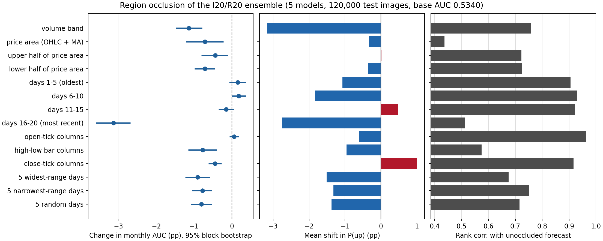
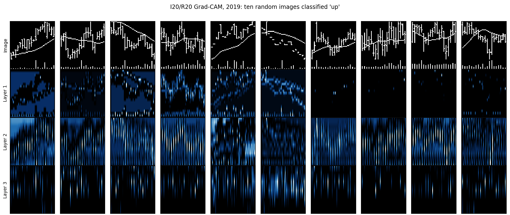

# (Re-)Imag(in)ing Price Trends: CNN Replication, Grad-CAM and Ablations

Source code for a replication and extension of Jiang, Kelly and Xiu, *(Re-)Imag(in)ing Price Trends* (Journal of Finance, 2023; working paper SSRN 3756587). The code trains the paper's 20-day-image / 20-day-return (**I20/R20**) convolutional neural network on stock price charts. It then studies which parts of the chart the network uses, in three ways:

1. **Grad-CAM** heatmaps, following §6.3 of the working paper, checked for faithfulness and stability.
2. **Inference-time region occlusion**: black out one part of the image and re-score with the trained models.
3. **Retrained volume ablation**: train the same models without the volume bars and compare.

## Main results

All results are out of sample for 2000–2019 (1,490,937 images) unless noted otherwise.

| | Paper-faithful CNN (5-seed ensemble) | Paper, I20/R20 (2001–2019) |
|---|---:|---:|
| Monthly cross-sectional AUC | 0.534 | – |
| Accuracy | 52.7% | 53.3% |
| Equal-weight long–short decile Sharpe ratio | 1.68 | 2.16 |

* **Grad-CAM.** Of the four patterns the paper reads from its heatmaps, only one holds across independently trained networks: "up" predictions draw the deepest layer's attention higher in the price chart than "down" predictions. Single-image heatmaps do no better than random pixels in a deletion test, and maps from different seeds are nearly uncorrelated.
* **Occlusion.** The most recent week of the chart carries almost all of the predictive power. Blacking out days 16–20 lowers AUC by 3.1 percentage points (pp); blacking out the volume band lowers it by 1.1 pp.
* **Volume ablation.** Retraining without volume bars costs **1.03 pp of AUC** (95% block-bootstrap interval [0.86, 1.21]). The loss is larger among small stocks.

| Occlusion of the trained ensemble | Grad-CAM replica of the paper's Figure 13 |
|---|---|
|  |  |

## Repository layout

```
.
├── study.py               # data loading/audit, train/val/test split, small CPU pilot, evaluation metrics
├── plot_results.py        # figures for the pilot volume-masking experiment
├── test_study.py          # unit tests for the split and the volume mask
├── results/               # pilot outputs
└── gradcam_ext/
    ├── common.py          # paper-faithful I20 CNN (708,866 parameters), receptive-field mapping, fast loader
    ├── train_baseline.py  # GPU training of the 5-seed ensembles (full images / volume removed)
    ├── evaluate.py        # out-of-sample metrics and the retrained volume ablation
    ├── gradcam.py         # Grad-CAM maps, figures, statistics, deletion and stability tests
    ├── gradcam_seeds.py   # Grad-CAM statistics repeated for every seed
    ├── occlusion.py       # inference-time region occlusion
    ├── test_gradcam.py    # tests: parameter count, feature-map shapes, receptive-field centres
    ├── models/            # trained weights: full_seed1-5.pt and no_volume_seed1-5.pt
    └── results/           # JSON summaries and figures used in the report
```

## Data

The image data (1993–2019, 20-day images with moving-average line and volume bars, 64×60 pixels) are **not** included in this repository. Download them from the authors' site:

* https://dachxiu.chicagobooth.edu/download/img_data.zip (about 567 MB zipped, 8.5 GB unpacked)
* Mirror used in the course: https://www.dropbox.com/s/njehqednn8mycze/img_data.zip?dl=0

Unpack the archive so that the yearly files sit in `data/course/monthly_20d/`:

```
data/course/monthly_20d/20d_month_has_vb_[20]_ma_1993_images.dat
data/course/monthly_20d/20d_month_has_vb_[20]_ma_1993_labels_w_delay.feather
...
```

Each `.dat` file holds `uint8` images of shape `(N, 64, 60)`. Image *i* corresponds to row *i* of the matching `.feather` label file. The label is `Ret_20d > 0`; rows with a missing return are dropped.

The split follows the course setup:

* **Development set:** January 1993 to November 1999, split randomly 70% training / 30% validation. December 1999 is held out so that development labels do not reach into the test period.
* **Test set:** every valid image from 2000–2019.

## Setup

Tested with Python 3.10, PyTorch 2.14 (CUDA 12.6) and an 8 GB RTX 4060 Laptop GPU.

```powershell
python -m venv .venv
.\.venv\Scripts\python.exe -m pip install torch --index-url https://download.pytorch.org/whl/cu126
.\.venv\Scripts\python.exe -m pip install -r requirements.txt
```

## Reproducing the results

Run the commands from the repository root (pilot) and from `gradcam_ext/` (everything else).

```powershell
# Tests (no data needed for test_gradcam)
python -m unittest -v test_study
cd gradcam_ext
python -m unittest -v test_gradcam

# 1. Train the paper-faithful ensembles (about 25 min per seed on an RTX 4060 Laptop GPU)
python train_baseline.py --features full
python train_baseline.py --features no_volume

# 2. Out-of-sample evaluation and retrained volume ablation
python evaluate.py

# 3. Interpretation
python gradcam.py          # Grad-CAM figures and statistics (2019 images)
python gradcam_seeds.py    # robustness across the five seeds
python occlusion.py        # region occlusion on 500 test images per month
```

The trained weights in `gradcam_ext/models/` let you skip step 1. Note that `evaluate.py` also needs the test-set predictions that step 1 writes to `gradcam_ext/predictions/`; these are not committed because of their size.

Run the GPU scripts one at a time. On a shared 8 GB GPU, two CUDA processes force each other into slow shared-memory paging.

### Pilot experiment (CPU)

`study.py` is a small CPU pilot of the volume-masking comparison. It uses a narrow network (width 8), 320 sampled images per month and two seeds:

```powershell
python study.py --width 8 --per-month 320 --epochs 6 --batch 256 --threads 8 --seeds 17 29
python plot_results.py
```

## Model and training details

* **Architecture.** Three blocks of 5×3 convolution → batch normalisation → LeakyReLU(0.01) → 2×1 max-pooling, with 64/128/256 filters. The first convolution uses vertical stride 3, dilation 2 and padding (12, 1). A 50% dropout layer feeds a linear layer with 46,080 inputs and 2 outputs. This gives 708,866 parameters, as in the paper.
* **Training.** Xavier initialisation, Adam with learning rate 1e-5, batch size 128 and cross-entropy loss. The training images are standardised. Mixed precision (bf16) is used for training; Grad-CAM is computed in fp32.
* **Early stopping.** Training stops after two epochs without validation improvement, but this counter starts only after epoch 5. This differs from the paper, where the counter starts immediately: with that rule, one seed stopped at epoch 4 with a validation loss worse than a constant forecast.
* **Ensemble.** Five seeds are trained per configuration and their predicted probabilities are averaged.

## Reference

Jiang, J., Kelly, B. and Xiu, D. (2023). (Re-)Imag(in)ing price trends. *Journal of Finance*, 78(6), 3193–3249. https://doi.org/10.1111/jofi.13268
